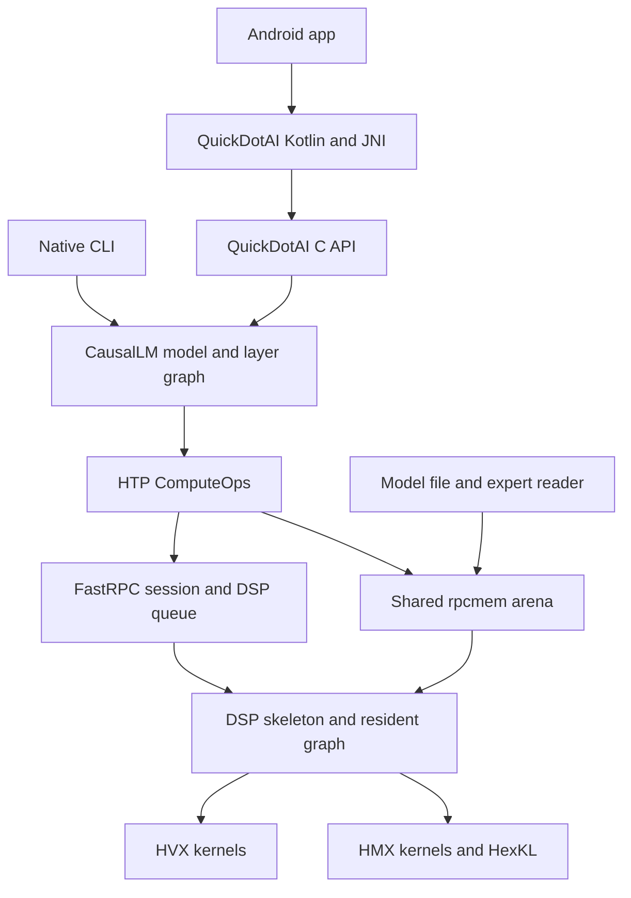

---
title: Hexagon HTP Backend Architecture
...

# Hexagon HTP Backend Architecture

The native HTP backend connects NNTrainer's ARM-side model graph to custom
Hexagon DSP kernels through FastRPC and DSP queues. The host manages model
loading, tokenization, weight residency and application control; supported
compute operations run on HVX and HMX, with HexKL supporting matrix kernels.
This is a separate implementation from the QNN backend.

For using the backend, start with [HTP Build](HTP_BUILD.md),
[HTP Model Preparation](HTP_MODEL_PREPARATION.md) and
[HTP Inference](HTP_INFERENCE.md). This page explains the shared components
and the contracts to preserve when changing them.

## Components and execution boundaries

The API adds catalog validation and exclusive HTP runtime ownership around
the same model implementations used by the CLI. A model layer selects
the HTP operations through its engine configuration. The ARM FastRPC stub
and DSP skeleton are generated from the same IDL and must be deployed with
compatible runtime libraries.

| Layer | Main responsibility | Source |
|---|---|---|
| Public API | Model selection, load checks, streaming, cancellation and handle lifecycle | [quick_dot_ai_api.cpp](../../Applications/CausalLM/api/quick_dot_ai_api.cpp) |
| HTP API owner | One active HTP handle, canonical DSP path, initialization and release | [htp_model_runtime.h](../../Applications/CausalLM/api/htp_model_runtime.h) |
| Model construction | Architecture-specific graph, weights and state | [Gemma4 model](../../Applications/CausalLM/models/gemma4/gemma4_htp_moe_causallm.cpp), [LFM2 model](../../Applications/CausalLM/models/lfm2_moe/lfm2_htp_moe_causallm.cpp) |
| Shared routed experts | Routing, expert residency and MoE execution | [lfm2_moe_layer.cpp](../../Applications/CausalLM/models/lfm2_moe/lfm2_moe_layer.cpp) |
| ARM compute adapter | Registration, prefill operations, graph setup and token-driver coordination | [htp_compute_ops.cpp](../../nntrainer/tensor/htp_backend/htp_compute_ops.cpp) |
| Transport/session | FastRPC, DSP library loading and queue ownership | [htp_backend.cpp](../../nntrainer/tensor/htp_backend/htp_backend.cpp) |
| Process runtime | Prepare/release entry points | [htp_context.cpp](../../nntrainer/htp_context.cpp) |
| DSP execution | Resident graph operations and token loop | [hexkl_graph.c](../../nntrainer/tensor/htp_backend/hmx/hexkl_graph.c), [hexkl_token.c](../../nntrainer/tensor/htp_backend/hmx/hexkl_token.c) |

The `lfm2_moe_layer` name does not mean that only LFM2 uses that layer.
Gemma4 also uses this shared expert machinery. Conversely, shared kernels
do not make model geometry, weight order or rotation metadata interchangeable.

## Load, prefill and decode

### Loading

The model reads its architecture and NNTrainer execution configuration,
constructs the graph, then loads weights according to that pack's record
layout. Dense matrices and resident experts are registered with the
backend. Experts that do not fit in the resident set remain available
through the model-file reader.

Registration binds packed weights and metadata to shared memory that the
DSP can access. The model's preparation step assembles the resident decode
graph and its parameters. It is not sufficient to change a dtype string:
the loader, tensor dimensions, binary offsets, registration layout and
kernel must agree on the actual representation.

### Prefill

Prefill processes the prompt through the model layers. Matrix work with
multiple input rows uses HMX where supported; HVX handles vector operations
and supporting transformations. For TL2 experts, packed panels are
expanded to the INT4 representation needed by HMX in DSP scratch space.
The model builds attention state, and LFM2 also updates convolution state.

Prefill produces the first output token. Its staging buffers have different
lifetimes from persistent weights and decode state. Before decode,
completed outputs are published and eligible prefill scratch is released.
CPU fallback scratch is allocated when the corresponding fallback needs it.
Release must follow completion of the operations that still use the buffers.

### Decode

The resident graph executes supported decode operations on the DSP,
reducing per-layer host calls. Native TL2 expert decode uses the HVX
lookup/GEMV path directly; it does not require a persistent expanded INT4
copy of every expert. The ARM side continues to service expert reads,
coordinate requests and deliver output to the caller.

The LM-head path depends on the weight format. The older Q4_0 integration
uses host/DSP paths specific to that pack. Native affine WH heads run on
HTP; Gemma4's large vocabulary projection is sliced, and prefill evaluates
the final input row rather than every prompt row. Avoid assuming that
every supported pack has identical CPU work or memory residency.

## Memory and expert residency

| Storage | Purpose and lifetime |
|---|---|
| ARM allocations and mappings | Tokenizer, model metadata, file access, host tensors and required fallback buffers |
| Shared rpcmem arena | DSP-visible registered weights, expert slots and other shared buffers |
| KV and convolution state | Per-prompt state whose representation and lifetime follow the model |
| DSP VTCM | Local scratch for tiles, expansion and intermediate compute; reused as kernels progress |

See [htp_rpcmem.h](../../nntrainer/tensor/htp_backend/htp_rpcmem.h) for the
arena and allocation helpers. Shared mappings can appear in more than one
memory counter; [HTP Performance](HTP_PERFORMANCE.md#memory-observations)
explains why process RSS alone is not a complete device memory budget.

`moe_cache_experts` describes resident capacity per expert layer. Startup
preload determines how much is loaded before inference, while speculative
prefetch brings likely future experts into spare slots. These are separate
controls. Demand reads must complete before a selected expert's slot is
used, and a slot must not be rebound while the DSP still consumes it.

Native TL2 uses compact arena slots containing its payload and metadata.
Legacy QS2 and prepared-convertible TL2 paths have different padded
layouts. On-disk offsets are not arena-capacity offsets, and a compact TL2
slot cannot be relabeled as QS2. See
[htp_prepared_tl2.h](../../nntrainer/tensor/htp_backend/htp_prepared_tl2.h).

The dedicated
[expert read pool](../../nntrainer/tensor/htp_backend/htp_expert_read_pool.h)
handles demand batches. Prefetch cancellation must retire stale work before
its buffers are reused. An optional
[token-completion hint](../../nntrainer/tensor/htp_backend/htp_token_completion.h)
lets the server stop polling early; it does not replace queue output/status
checks or turn a partial operation into success.

## Model-specific contracts

| Aspect | Gemma4 HTP | LFM2 HTP |
|---|---|---|
| Decoder structure | Local/global attention, dense FFN and routed experts | Hybrid short-convolution/attention layers with dense and routed FFNs |
| Routed-expert activation | GeGLU | SwiGLU |
| Routing | Gemma4 softmax-based routing | Sigmoid routing with expert bias and normalized selected weights |
| Supported pack families | Original QS2/QS4 and native TL2/affine, including configured mixed experts | SR15 `sr15_v2` only |
| Attention cache contract | `q8` | `q8_row` for the model's unnormalized value projections |
| Rotated checkpoint metadata | Sign JSON with the Gemma4 transform convention | Binary basis/sign records located through the SR15 conversion report |
| Additional prompt state | Attention state | Attention plus short-convolution state |

The model setup methods enforce geometry, dtype and engine constraints.
WH-formatted expert layers require HTP execution. LFM2's fused profile
requires its HTP engines together and rejects CPU/GPU mixing, memory swap
and the KV window ring. A generic API capability or shared layer does not
override these model checks.

## KV state and repeated prompts

Quantized attention cache state includes scales as well as stored rows.
When a windowed cache drops old rows, those rows can still matter to the
scale used to seed decode attention. The current implementation preserves
their per-column maximum absolute values in `KVCacheManager`, folds them
into the HTP attention layer, and sends a scale floor through
`attn_m1_kv_amax_floor` before decode seeding. The DSP combines that floor
with the maxima of the remaining seed rows.

For snapshot use, the floor is retained in the `.q2` calibration sidecar.
LFM2's snapshot path additionally requires a `.conv` companion containing
short-convolution state. Snapshot metadata, geometry and position are
part of the state contract. A loaded prefix also consumes context space:
the prompt-budget check accounts for its rows and refuses overflow before
cache loading and prefill.

Relevant implementations are
[kv_cache_manager.cpp](../../Applications/CausalLM/kv_cache_manager.cpp),
[htp_mha_core.cpp](../../Applications/CausalLM/layers/htp_mha_core.cpp) and
[the shared generation loop](../../Applications/CausalLM/models/causal_lm.cpp).
The [windowed-cache record](../gemma4-htp-kv-cache-s25u.md) explains the
specific mismatch fixed by the scale floor. Other differences between
snapshot/chunked and full-prefill calibration still need fixture-specific
validation.

QuickDotAI HTP requests start independent prompts while retaining loaded
weights. Repeat execution resets the DSP decode state and host cache
bindings; LFM2 also resets convolution state. Public loaders reject enabled
snapshot options. Releasing a handle must retire workers and model state
before closing the runtime or allowing another HTP model to acquire it.

## Configuration and interface changes

Configuration has three levels:

- **Pack contract:** Model geometry, weight dtypes, engines, rotation and
  state formats. These must agree with the converted data.
- **Compiled backend defaults:** Defined in
  [htp_fixed_opts.h](../../nntrainer/tensor/htp_fixed_opts.h).
- **Process-level overrides and CLI policy:** Environment settings and the
  [LFM2 CLI preset](../../Applications/CausalLM/lfm2_runtime_defaults.h).
  The API does not install that preset, and some options are read only once.

For a new operation or format, follow the data through all boundaries:

1. Define the record/operation contract and an independent reference.
2. Update the model/layer dispatch and ARM registration or compute adapter.
3. Update [nntr_hvx.idl](../../test/htp/nntr_hvx.idl) when the remote
   interface changes, and implement the DSP entry point and kernels.
4. For resident decode, update the
   [graph descriptor](../../nntrainer/tensor/htp_backend/htp_graph_desc.h)
   and dispatcher; update the
   [queue wire format](../../nntrainer/tensor/htp_backend/htp_dspq_wire.h)
   if transport messages change.
5. Include new sources in the DSP build and applicable host build. Generate
   the ARM stub and DSP skeleton together, then rebuild and redeploy both.
6. Add the relevant serialization, arithmetic, bounds and ownership checks,
   then validate device output and lifecycle as described in
   [HTP Validation](HTP_VALIDATION.md).

Supporting another model requires its own graph, converter and geometry
checks as well as device validation. Registering a catalog name or choosing
`engine=htp` does not supply those contracts automatically.
